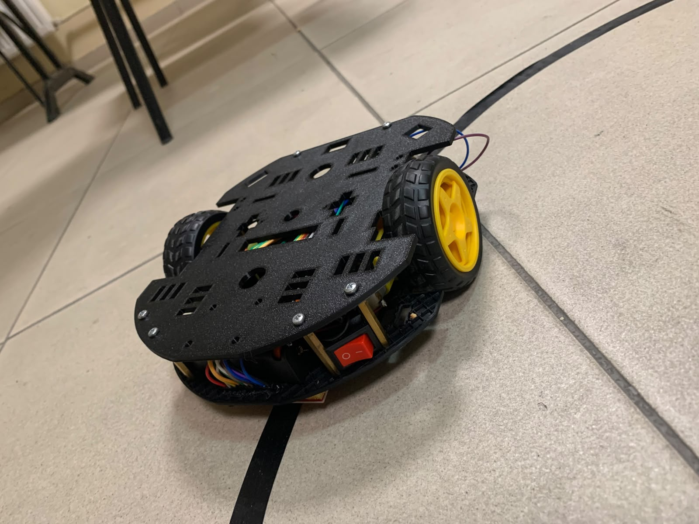
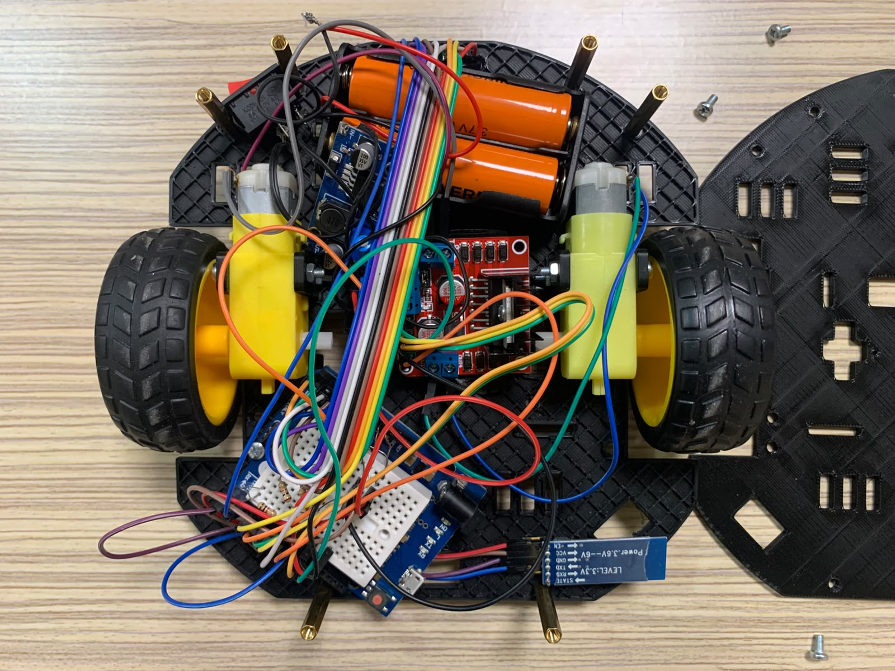
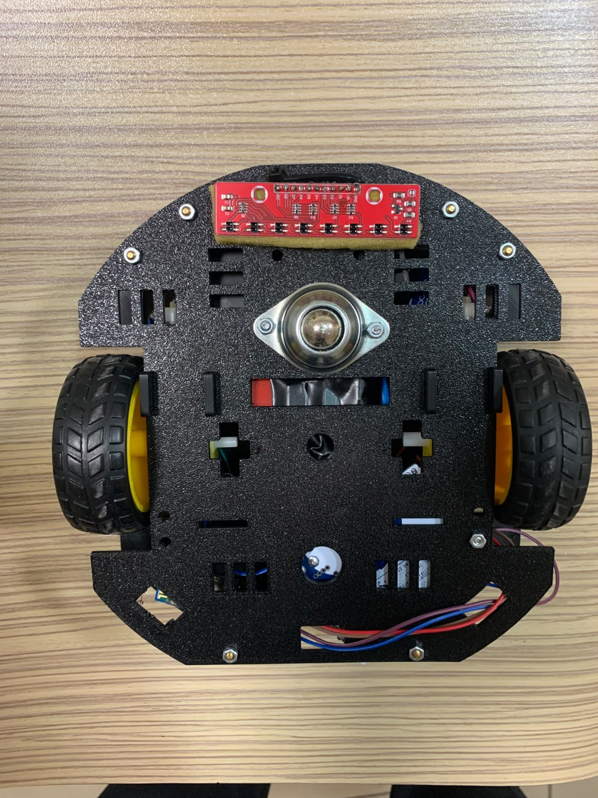
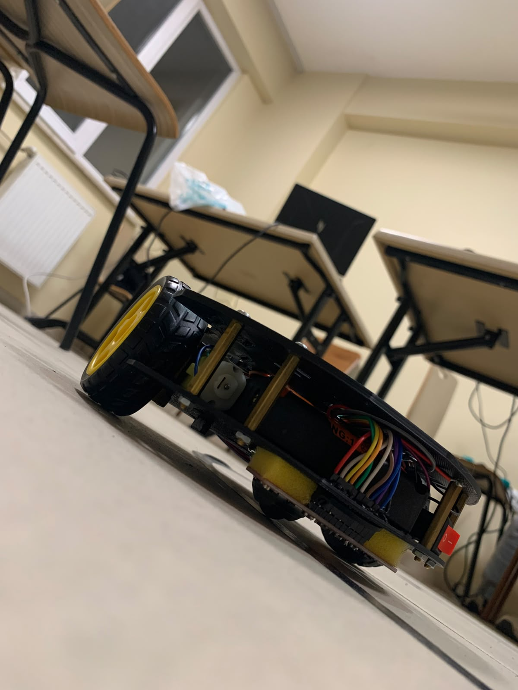

# Z-AGV

Endüstri 4.0 kapsamında çizgi izleyen, birkaç yüz gramlık yük taşıyan ve çevrimdışı Web SCADA arayüzüyle yönetilen kablosuz AGV (Otonom Yönlendirilmiş Araç) prototipi.

```text
[Web SCADA (Tarayıcı / PWA)]
        ↕  WebSocket JSON
[Python FastAPI + PySerial Köprüsü]
        ↕  Bluetooth SPP (9600 bps, \n)
[HC-05 Bluetooth Modülü]
        ↕  Hardware UART Serial1 (D0/D1)
[Arduino Leonardo (ATmega32U4)]
        ↕  PWM + Dijital Yön + 8 Kanal ADC
[L298N Sürücü + 2x TT Motor + 8'li Analog IR Dizisi]
```

| Ön-sol görünüm ve fiziksel E-Stop anahtarı | Üst kapak açık iç donanım yerleşimi |
| :---: | :---: |
|  |  |
| **Alt şasi, IR bar ve bilyalı sarhoş teker** | **Ön burun zemin seviyesi ve sensör yüksekliği** |
|  |  |

## İçindekiler

- [Donanım ve malzeme listesi](#donanım-ve-malzeme-listesi)
- [Güç dağıtımı ve genel devre şeması](#güç-dağıtımı-ve-genel-devre-şeması)
- [Arduino Leonardo doğrulanmış pin haritası](#arduino-leonardo-doğrulanmış-pin-haritası)
- [Adım adım devre kurulum rehberi](#adım-adım-devre-kurulum-rehberi)
- [Proje dizin yapısı](#proje-dizin-yapısı)
- [Yazılım kurulumu ve çalıştırma](#yazılım-kurulumu-ve-çalıştırma)
- [Web SCADA arayüzü ve klavye kısayolları](#web-scada-arayüzü-ve-klavye-kısayolları)
- [Seri haberleşme protokolü ve güvenlik mimarisi](#seri-haberleşme-protokolü-ve-güvenlik-mimarisi)
- [Kalibrasyon, PD kazanç ayarı ve motor trim](#kalibrasyon-pd-kazanç-ayarı-ve-motor-trim)
- [Sorun giderme](#sorun-giderme)

## Donanım ve malzeme listesi

Projede standart Arduino Uno yerine Arduino Leonardo seçtik. Uno kartında yalnızca 6 analog giriş bulunur ve Bluetooth modülü için ayrı bir donanımsal UART portu yoktur. Leonardo üzerindeki ATmega32U4 mikrodenetleyicisi 12 analog kanal sunar. Ayrıca USB haberleşmesinden bağımsız çalışan `Serial1` birimi (`D0` ve `D1`) kırılgan `SoftwareSerial` çakışmalarını ortadan kaldırır.

| Bileşen | Teknik özellik / model | Adet | Sistemdeki görevi |
| :--- | :--- | :---: | :--- |
| Mikrodenetleyici | Arduino Leonardo (ATmega32U4, 16 MHz, 32 KB Flash, 2,5 KB SRAM) | 1 | 8 kanal ADC okuma, 100 Hz PD kontrol ve `Serial1` haberleşme |
| Motor sürücü | L298N Çift H-Köprüsü (~1,8-2,0 V iç gerilim düşümü) | 1 | İki TT motoru yön pinleri ve PWM ile sürer |
| Çizgi sensörü | 8'li analog IR sensör dizisi (`GND, IR, D1-D8, VCC`, QTR-8A benzeri) | 1 | Siyah çizgi yansımasını 0-1023 arası analog gerilimle ölçer |
| Bluetooth modülü | HC-05 Bluetooth SPP modülü (9600 bps, 3,3 V mantık seviyesi) | 1 | Bilgisayarla kablosuz seri haberleşme kurar |
| Voltaj regülatörü | Ayarlanabilir DC-DC Step-Down (Buck) modül (ör. LM2596, 5,00 V çıkış) | 1 | Leonardo, HC-05 ve IR sensör barına temiz 5,00 V sağlar |
| Enerji kaynağı | Seri bağlı 2 adet 18650 Li-Ion pil + 2'li pil yatağı (7,4 V nominal, 8,4 V dolu) | 1 takım | Tahrik ve kontrol sistemini besler (2S LiPo pil de olur) |
| Fiziksel E-Stop | 10 A ve üzeri kırmızı beşik anahtar (Rocker / Toggle) | 1 | Pil `+` hattını donanımsal olarak anında keser |
| Kondansatör | 16 V 100 µF elektrolitik kondansatör (5 V hattında 16 V 47 µF de olur) | 4 | 3 adedi pil hattı çökmesini, 1 adedi 5 V hattı parazitini sönümler |
| Direnç | 1 kΩ ve 2 kΩ (1/4 W) | 1'er | Leonardo `TX1` (5 V) çıkışını HC-05 `RXD` için 3,33 V'a düşürür |
| Mini breadboard | 170 pin veya 400 pin bağlantı tablası | 1 | Gerilim bölücüyü, 5 V hattını ve ortak `GND` dağıtımını toplar |
| Tahrik ve şasi | 2 adet sarı TT redüktörlü DC motor (6 V) + lastik tekerlek + metal sarhoş teker | 1 takım | Diferansiyel sürüş, mekanik denge ve çift katlı şasi |
| Kablolama | Erkek-dişi / erkek-erkek Dupont kablolar ve güç hattı için 18-20 AWG kablo | Yeterli | Sinyal ve yüksek akımlı besleme bağlantıları |

Kurulum için şu el aletleri gerekir:
- Doğrulama ve kısa devre ölçümü için dijital multimetre
- Pil anahtarı ve motor kabloları için havya ile lehim teli (klemensli bağlantıda uygun tornavida da yeter)
- Küçük yıldız ve düz tornavida, yan keski ve makaron veya elektrik bandı

## Güç dağıtımı ve genel devre şeması

Mobil robotlarda en sık görülen arıza motorların kalkış anında çektiği ani akımın pil gerilimini düşürüp mikrodenetleyiciyi sıfırlamasıdır. Bunu önlemek için motor gücünü ve mantık devresi beslemesini ayrı dallara böldük. Pil `+` hattı önce 10 A üzeri fiziksel E-Stop anahtarından geçip ardından L298N güç girişine ve Step-Down regülatörüne ulaşır.

```text
[2x18650 / 2S Pil (+)] ──▶ [10 A+ Fiziksel E-Stop] ──▶ (+V Ana Hat: 7,4-8,4 V)
                                                           ├──▶ L298N [12V / VMS]
                                                           ├──▶ Step-Down [IN+]
                                                           └──▶ 3x [16V 100uF] (+) Bacakları

(Ortak GND / Pil (-))
  ├──▶ L298N [GND]
  ├──▶ Step-Down [IN-] ve [OUT-]
  ├──▶ 4 adet [16V 100uF] (-) Beyaz Şeritli Bacaklar
  ├──▶ Arduino Leonardo [GND]
  ├──▶ HC-05 [GND]
  ├──▶ 8'li IR Sensör [GND]
  └──▶ Gerilim Bölücü [2 kOhm] Alt Ucu

[Step-Down OUT+ = 5,00 V] ──▶ 1x [16V 100uF] (+) Bacağı
                           ├──▶ Arduino Leonardo [5V]  (DİKKAT: VIN pinine takmayın!)
                           ├──▶ HC-05 [VCC]
                           └──▶ 8'li IR Sensör [VCC]
```

HC-05 modülünün besleme pini 5 V toleranslıdır ama `RXD` veri girişi 3,3 V mantık seviyesiyle çalışır. Leonardo'nun `Pin 1 (TX1)` çıkışından gelen 5 V sinyali modüle doğrudan vermemek için mini breadboard üzerinde `1 kΩ` ve `2 kΩ` dirençlerle pasif gerilim bölücü kurduk. Bölücü çıkışındaki gerilim tam `3,33 V` düzeyine iner:

```text
Arduino Leonardo Pin 1 (TX1, 5,00 V)
        │
     [1 kΩ]
        ├──────────────▶ HC-05 RXD (3,33 V)
     [2 kΩ]
        │
   Ortak GND
```

`V_RXD = 5,00 × 2000 / (1000 + 2000) = 3,33 V`

Devreyi kurarken uyulması gereken temel güç kuralları şunlardır:
1. Arduino Leonardo'yu `VIN` yerine doğrudan `5V` pininden besleyin. Kartın dahili regülatörü `VIN` üzerinden ~1,5 V düşüm ister ve 5,00 V girişte kararlı çalışmaz.
2. L298N kartının üzerindeki `5V` klemensini boş bırakın. Step-Down dışarıdan 5,00 V verdiği için iki voltaj regülatörünü aynı hatta bağlamak kartlara zarar verir.
3. Bilgisayardan USB ile kod yüklerken fiziksel E-Stop anahtarını mutlaka kapalı tutun. Aksi hâlde USB'nin 5 V hattı ile Step-Down'ın 5,00 V çıkışı `5V` pininde çakışır.
4. Pil gerilimi toplam `6,4 V` altına indiğinde (hücre başına 3,2 V) aracı durdurup pilleri şarj edin.

## Arduino Leonardo doğrulanmış pin haritası

Arduino çekirdeğinin ATmega32U4 varyant tanımlarına (`pins_arduino.h`) göre donanım çakışması doğurmayacak pin eşleştirmesini seçtik. Bu kartta `A6` analog kanalı Dijital Pin `4` üzerinde, `A8` kanalı ise Dijital Pin `8` üzerinde yer alır. Bunlar dışında `3` numaralı pin ile `10` ve `13` numaralı pinler boştadır.

### HC-05 Bluetooth bağlantıları

| HC-05 pini | Leonardo pini / hat | Açıklama |
| :--- | :--- | :--- |
| `VCC` | Step-Down `5,00 V` | 5 V besleme |
| `GND` | Ortak `GND` | Ortak şase |
| `TXD` | `Pin 0 (RX1)` | Doğrudan UART alma bağlantısı |
| `RXD` | `Pin 1 (TX1)` | `1 kΩ` / `2 kΩ` gerilim bölücü düğümünden 3,33 V sinyal |
| `EN` / `STATE` | Boşta | Standart 9600 bps veri modunda bağlanmaz |

### L298N motor sürücü bağlantıları

| L298N pini | Leonardo pini / hat | Tip ve görev |
| :--- | :--- | :--- |
| `ENA` | `Pin 5` | Donanımsal PWM - Sol motor hızı (üzerindeki jumper çıkarılır) |
| `IN1` | `Pin 6` | Dijital çıkış - Sol motor yön 1 |
| `IN2` | `Pin 7` | Dijital çıkış - Sol motor yön 2 |
| `IN3` | `Pin 11` | Dijital çıkış - Sağ motor yön 1 |
| `IN4` | `Pin 12` | Dijital çıkış - Sağ motor yön 2 |
| `ENB` | `Pin 9` | Donanımsal PWM - Sağ motor hızı (üzerindeki jumper çıkarılır) |
| `12V / VMS` | `+V` Ana Hat (7,4-8,4 V) | Fiziksel E-Stop çıkışından gelen pil gücü |
| `GND` | Ortak `GND` | Pil eksisi ve mantık devresiyle ortak şase |
| `5V` | Boşta | Harici Step-Down kullanıldığı için bağlanmaz |
| `OUT1 / OUT2` | Sol TT motor | Sol tekerlek motor uçları |
| `OUT3 / OUT4` | Sağ TT motor | Sağ tekerlek motor uçları |

### 8'li analog IR çizgi sensörü bağlantıları

| Sensör pini | Leonardo pini / hat | ADC kanalı ve görev |
| :--- | :--- | :--- |
| `VCC` | Step-Down `5,00 V` | Sensör beslemesi |
| `GND` | Ortak `GND` | Ortak şase |
| `IR` | `Pin 2` | Dijital çıkış (`IR_LED_ON = HIGH` ile IR LED'leri sürer) |
| `D1` (En sol) | `A0` | Analog okuma (`analogRead(A0)`) |
| `D2` | `A1` | Analog okuma (`analogRead(A1)`) |
| `D3` | `A2` | Analog okuma (`analogRead(A2)`) |
| `D4` | `A3` | Analog okuma (`analogRead(A3)`) |
| `D5` | `A4` | Analog okuma (`analogRead(A4)`) |
| `D6` | `A5` | Analog okuma (`analogRead(A5)`) |
| `D7` | `Pin 4 (A6)` | Analog okuma (`analogRead(A6)`) |
| `D8` (En sağ) | `Pin 8 (A8)` | Analog okuma (`analogRead(A8)`) |

Araca üstten ve ön gidiş yönüne bakıldığında `D1` en soldaki, `D8` en sağdaki kanal olur. Şasiyi ters çevirip alttan baktığınızda sıra sağdan sola doğru `D1-D8` biçiminde görünür.

## Adım adım devre kurulum rehberi

Devreyi ilk kez toplarken aşağıdaki sırayı bozmadan ilerleyin. Tek bir yanlış kablolama HC-05 alıcısını veya Leonardo kartını yakabilir. Her adımı bitirip bağlantıyı gözle denetlemeden sonraki aşamaya geçmeyin.

### Adım 1: Mekanik şasi, motor ve sensör yerleşimi

İki adet sarı TT redüktörlü motoru alt şasiye paralel yerleştirip tekerlekleri takın. Bilyalı sarhoş tekerleği arka veya ön denge noktasına, 360° döner kafası vidalara ve kablolara takılmayacak biçimde vidalayın. Sarhoş tekerlek dönüş sırasında takılırsa 180° manevrada araç eksenden sapar.

8'li analog IR sensör barını şasinin en ön ucuna, yerden `3-5 mm` yükseklikte ve zemine tam paralel olacak şekilde yükseltici sünger veya takozla sabitleyin. Üst yük tablasına ağırlık konduğunda şasi esneyip sensör kartını yere sürtmemelidir. 2x18650 pil yatağını ise ağırlık merkezini tahrik eksenine yakın tutmak için iki tekerlek arasına ya da hemen önüne yerleştirin. Fiziksel E-Stop anahtarını da acil durumda kolay erişilebilecek sol yan açıklığa monte edin.

### Adım 2: Step-Down regülatörün sistemden bağımsız 5,00 V ayarı

Bu adım kesinlikle atlanmamalı. Step-Down modülü hiçbir karta lehimlemeden ya da bağlamadan önce yalnızca pil yatağına bağlayın. Arduino, L298N, HC-05 ve IR sensörü bu aşamada kenarda dursun.

Multimetreyi DC Volt (20 V) kademesine alıp probları modülün `OUT+` ve `OUT-` çıkışlarına tutun. Modül üzerindeki pirinç ayar potansiyometresini küçük düz tornavidayla çevirerek çıkış gerilimini tam `5,00 V` yapın. Ayar tamamlandığında pilleri yataktan çıkarın.

### Adım 3: Fiziksel E-Stop ve 7,4-8,4 V ana güç hattı

Piller yataktan çıkıkken 18-20 AWG kalın kablo kullanarak pil yatağının kırmızı `+` ucunu fiziksel E-Stop anahtarının bir bacağına bağlayın. Anahtarın diğer bacağını ana güç düğümü (`+V`) olarak L298N üzerindeki `12V / VMS` klemensine ve Step-Down modülünün `IN+` ucuna götürün. Pil yatağının siyah `-` ucunu da L298N `GND` klemensiyle Step-Down `IN-` ucuna ortaklayın.

Şimdi motor kalkış çökmesini bastırmak için 3 adet `16V 100 µF` elektrolitik kondansatörü `+V` ile ortak `GND` arasına paralel bağlayın. Ters bağlanan elektrolitik kondansatör ısınıp şişer. Kondansatör gövdesindeki beyaz şeritli kısa bacak her zaman `-` (`GND`), uzun bacak ise `+V` hattına gitmelidir.

### Adım 4: 5,00 V mantık besleme hattı ve ortak GND dağıtımı

Mini breadboard üzerinde bir uzun rayı `5,00 V`, diğer uzun rayı da ortak `GND` hattı olarak ayırın. Step-Down modülünün `OUT+` çıkışını breadboard'un `5V` rayına, `OUT-` çıkışını ortak `GND` rayına bağlayın. Step-Down `GND` hattı ile pil `GND` hattının aynı referansta birleştiğinden emin olun.

Breadboard üzerindeki `5V` ve `GND` rayları arasına 4'üncü `16V 100 µF` (veya `47 µF`) kondansatörü beyaz şeridi `GND`'ye gelecek biçimde yerleştirin. Ardından `5V` rayından Arduino Leonardo'nun `5V` pinine, `GND` rayından ise Leonardo'nun `GND` pinine kablo çekin. Leonardo üzerindeki `VIN` pinini boş bırakın.

### Adım 5: L298N hazırlığı ve motor bağlantıları

L298N kartının ön kenarındaki `ENA` ve `ENB` pinlerinin üzerinde bulunan iki siyah plastik jumper'ı çıkarın. Jumper takılı kalırsa hız kontrolü ve PD düzeltmesi çalışmaz. Ayrıca L298N kartının `5V` etiketli vidalı klemensine hiçbir kablo takmayın.

Şimdi L298N ile Leonardo arasındaki 6 sinyal kablosunu çekin. Sol motor için `ENA -> Pin 5` ile `IN1 -> Pin 6` / `IN2 -> Pin 7`, sağ motor için ise `ENB -> Pin 9` ile `IN3 -> Pin 11` / `IN4 -> Pin 12` bağlantılarını yapın. Son olarak sol motor kablolarını L298N üzerindeki `OUT1 / OUT2`, sağ motor kablolarını da `OUT3 / OUT4` klemenslerine vidalayın. Motor yönleri ters çıkarsa bunu son adımda iki kabloyu yer değiştirerek düzelteceksiniz.

### Adım 6: HC-05 Bluetooth ve 1 kΩ / 2 kΩ gerilim bölücü kurulumu

HC-05 modülünün `VCC` pinini breadboard'daki `5V` rayına, `GND` pinini ortak `GND` rayına bağlayın. Modülün `TXD` ucunu doğrudan Arduino Leonardo `Pin 0 (RX1)` pinine takın. `EN` ve `STATE` pinlerini boşta bırakın.

Arduino `Pin 1 (TX1)` çıkışı ile HC-05 `RXD` arasına breadboard üzerinden gerilim bölücü kurun:
1. `Pin 1 (TX1)` ucundan breadboard üzerinde boş bir beşli satıra kablo çekin.
2. Bu satırdan yeni ve boş bir satıra `1 kΩ` direnç köprüsü atın.
3. Aynı ara satıra hem HC-05 `RXD` kablosunu hem de ortak `GND` rayına inen `2 kΩ` direncin bir bacağını takın.

### Adım 7: 8'li analog IR sensör kablolaması

Sensör barının `VCC` pinini `5V` rayına, `GND` pinini ortak `GND` rayına bağlayın. Kart üzerindeki `IR` (LEDON) pinini Arduino Leonardo `Pin 2` pinine götürün. Ardından `D1-D6` kanallarını sırasıyla `A0-A5` pinlerine bağlayın.

Son iki kanal için standart analog etiketlerin yanındaki dijital pinleri kullanacaksınız: `D7` kanalını Dijital Pin `4` (`A6`) pinine, `D8` kanalını ise Dijital Pin `8` (`A8`) pinine takın. Kablo demetini şasinin altından yukarı geçirirken lastik tekerleklere veya dönen sarhoş tekerleğe sürtmeyecek biçimde toplayın.

### Adım 8: Enerji vermeden önce multimetre kontrolü

Piller hâlâ takılı değilken ve E-Stop kapalıyken multimetreyi süreklilik (bip / diyot) kademesine alıp şu 5 kontrolü yapın:
- `+V` ana hattı ile ortak `GND` arasında kısa devre (bip sesi) olmadığını doğrulayın.
- `5V` rayı ile ortak `GND` arasında kısa devre olmadığını doğrulayın.
- L298N `GND`, Step-Down `OUT-`, Arduino `GND`, HC-05 `GND` ve IR sensör `GND` noktalarının hepsinde ortak süreklilik ölçün.
- Dört elektrolitik kondansatörün de beyaz şeritli `-` bacağının `GND` ile birleştiğini gözle kontrol edin.
- Direnç (Ω) kademesinde Leonardo `Pin 1 (TX1)` ile HC-05 `RXD` arasını ~`1 kΩ`, HC-05 `RXD` ile `GND` arasını ise ~`2 kΩ` ölçün.

### Adım 9: USB üzerinden ilk gömülü yazılım yüklemesi

Fiziksel E-Stop anahtarının **KAPALI (`0`)** olduğundan ve pillerin çıkık olduğundan emin olun. Arduino Leonardo'yu mikro-USB kablosuyla bilgisayara bağlayın ve sonraki bölümdeki `arduino-cli` ya da `./scripts/upload.sh` komutuyla [agv_leonardo.ino](firmware/agv_leonardo/agv_leonardo.ino) kodunu yükleyin. Yükleme bitince USB kablosunu çıkarın.

### Adım 10: İlk enerjilendirme, IR LED ve motor yön testi

Robotu iki tahrik tekerleği yerden kesilecek biçimde bir takoz veya kutu üzerine koyun. Pilleri kutuplara (`+`/`-`) dikkat ederek yatağa takın ve fiziksel E-Stop anahtarını açın. İlk anda Step-Down çıkışının `5,00 V` civarında kaldığını multimetreyle son kez doğrulayın.

HC-05 üzerindeki kırmızı/mavi LED hızlı yanıp sönmeye başlayacaktır. Akıllı telefon kamerasını IR sensör barının altına tuttuğunuzda 8 kızılötesi LED'in morumsu parlak yandığını görmeniz gerekir. LED'ler karanlıksa kartınız `LOW` tetiklemelidir; [agv_leonardo.ino](firmware/agv_leonardo/agv_leonardo.ino#L10) dosyasındaki `#define IR_LED_ON HIGH` satırını `LOW` yapıp kodu tekrar yükleyin.

Son olarak bilgisayardan Web SCADA portalına bağlanıp düşük manuel hızda (`VM:120`) kısa süre İleri (`W`) ve Sola (`A`) basın:
- İleri komutunda iki tekerlek de aracın ön burun yönüne dönmelidir. Ters dönen motorun L298N üzerindeki iki klemens kablosunu (`OUT1-OUT2` veya `OUT3-OUT4`) birbiriyle değiştirin.
- Sola dönüş (`A`) komutunda sağ tekerlek ileri, sol tekerlek geri dönmelidir. Terse dönme varsa sol ve sağ motor kablolarını L298N çıkışlarında yer değiştirin.

## Proje dizin yapısı

```text
Z-AGV/
├── firmware/
│   └── agv_leonardo/
│       └── agv_leonardo.ino        # 100 Hz PD, EEPROM, E-STOP, 180° dönüş ve Watchdog kodu
├── backend/
│   ├── requirements.txt            # FastAPI, Uvicorn ve PySerial bağımlılıkları
│   └── server.py                   # Async WebSocket köprüsü, 10 Hz heartbeat ve port keşfi
├── frontend/
│   ├── index.html                  # Çevrimdışı Web SCADA yerleşimi ve Komut Kılavuzu
│   ├── style.css                   # SCADA arayüz stilleri ve iOS dokunma koruması
│   ├── app.js                      # WebSocket istemcisi, güvenli D-Pad ve kısayollar
│   ├── manifest.webmanifest        # Standalone PWA bildirimi
│   └── icons/                      # Yerel SVG ve PNG (192x192, 512x512) uygulama simgeleri
├── scripts/
│   ├── upload.sh                   # arduino-cli ile Leonardo derleme ve USB yükleme betiği
│   ├── start-server.sh             # UFW geçici kuralı, rfcomm bağlama ve sunucu başlatıcı
│   └── test.sh                     # Python entegrasyon ve firmware derleme test betiği
├── tests/
│   └── test_backend.py             # Sanal PTY mock Leonardo, güvenlik ve PWA testleri
└── images/                         # Fiziksel prototip fotoğrafları
```

## Yazılım kurulumu ve çalıştırma

Sistemde Python 3.10 veya üstü, Arduino yüklemesi için `arduino-cli` (ya da Arduino IDE) ve Linux üzerinde `bluez` (`bluetoothctl`, `rfcomm`) paketleri gerekir.

### 1. Gömülü yazılımı derleme ve yükleme

İlk kurulumda AVR çekirdeğini indirin:

```bash
arduino-cli core update-index
arduino-cli core install arduino:avr
```

Fiziksel E-Stop kapalıyken Leonardo'yu USB'ye takıp tek komutla derleyip yükleyin (port farklıysa argüman olarak verin):

```bash
./scripts/upload.sh /dev/ttyACM0
```

İsterseniz derleme ve yüklemeyi doğrudan `arduino-cli` ile de yapabilirsiniz:

```bash
arduino-cli compile --fqbn arduino:avr:leonardo --warnings all firmware/agv_leonardo
arduino-cli upload -p /dev/ttyACM0 --fqbn arduino:avr:leonardo firmware/agv_leonardo
```

### 2. Python sanal ortamını kurma

```bash
python3 -m venv .venv
.venv/bin/pip install -r backend/requirements.txt
```

### 3. HC-05 Bluetooth eşleştirme ve seri port bağlama

#### Linux

Robot enerjiliyken HC-05 modülünü `bluetoothctl` üzerinden eşleştirin (varsayılan PIN genelde `1234` veya `0000` olur):

```bash
bluetoothctl
power on
agent on
default-agent
scan on
# Çıktıda HC-05 MAC adresini görünce taramayı durdurun:
scan off
pair <HC05_MAC_ADRESI>
trust <HC05_MAC_ADRESI>
quit
```

Ardından sanal seri portu (`/dev/rfcomm0`) oluşturun ve kullanıcınıza seri port grubunu tanımlayın:

```bash
sudo rfcomm bind 0 <HC05_MAC_ADRESI> 1
# Debian / Ubuntu için:
sudo usermod -aG dialout "$USER"
# Arch Linux için:
sudo usermod -aG uucp "$USER"
```

Grup değişiminin geçerli olması için oturumu kapatıp yeniden açın.

> Not: [scripts/start-server.sh](scripts/start-server.sh#L29) dosyası örnek bir MAC adresiyle (`00:21:07:00:4F:AE`) `rfcomm bind 0` çalıştırır. Kendi modülünüze göre o satırdaki MAC adresini güncelleyin. Betik ayrıca sistemde `ufw` güvenlik duvarı etkinse geçici olarak `8000/tcp` portunu açar ve sunucu kapandığında kuralı otomatik siler.

#### Windows

Windows Bluetooth ayarlarından HC-05 cihazını eşleştirdikten sonra `Bluetooth Ayarları -> COM Bağlantı Noktaları` sekmesinden **Giden (Outgoing)** yönlü COM port numarasını (ör. `COM5`) not alın. Sunucuyu şu komutla başlatın:

```powershell
.venv\Scripts\python.exe backend\server.py
```

### 4. Sunucuyu ve Web SCADA arayüzünü başlatma

```bash
./scripts/start-server.sh
```

Doğrudan Python ile başlatmak isterseniz `.venv/bin/python backend/server.py` komutunu kullanabilirsiniz. Tarayıcıdan şu adreslere girin:
- Aynı bilgisayardan: `http://localhost:8000`
- Aynı yerel ağdaki telefon veya tabletten: `http://<BILGISAYAR_IP_ADRESI>:8000`

Arayüz sıfır harici CDN bağımlılığıyla tamamen çevrimdışı çalışır. Telefon tarayıcısında "Ana Ekrana Ekle" seçeneğiyle standalone PWA modunda tam ekran kumanda olarak da kullanabilirsiniz.

### 5. Otomatik testleri çalıştırma

```bash
./scripts/test.sh
```

Bu betik önce [tests/test_backend.py](tests/test_backend.py) içindeki sanal PTY mock Leonardo entegrasyon testlerini, çevrimdışı/PWA denetimlerini, E-Stop kilit doğrulamasını, son istemci failsafe testini ve `1,20 s` hat kopma kontrolünü çalıştırır. Ardından Leonardo firmware'ini `--warnings all` ile sıfır uyarı verecek şekilde derler. Referans derlemede bellek kullanımı Flash için `15.920 byte` (%55), SRAM için `828 byte` (%32) düzeyindedir.

## Web SCADA arayüzü ve klavye kısayolları

Web arayüzü 10 Hz hızında akış alan RTT gecikme ve telemetri frekansı sayaçlarını, 8 kanallı canlı IR sensör çubuklarını, çift yönlü sol/sağ PWM göstergelerini ve akıllı kaydırmalı 300 satırlık seri konsolu tek ekranda sunar. Konsoldaki `Ping/TEL Gizle` kutusu varsayılan olarak açık gelir ve periyodik karelerin hata/onay mesajlarını boğmasını önler. Konsolun altındaki açılır **Komut Kılavuzu** ise tüm seri komutları listeleyip tek dokunuşla giriş kutusuna doldurur.

| İşlev / düğme | Klavye kısayolu | Kapsam ve davranış |
| :--- | :--- | :--- |
| Acil Durdurma (`E-STOP`) | `Ctrl + Shift + E` | Global kısayol. Metin kutusu odakta olsa bile anında `E` gönderir |
| Çizgi İzle (`L`) | `L` | Metin kutuları dışında otonom `LINE` modunu başlatır |
| Dur (`S`) | `Space` | Metin kutuları dışında hem otonom modu hem manuel sürüşü durdurur |
| 180° Dön (`U`) | `Ctrl + U` | Sensör güdümlü 180° dönüş manevrasını başlatır |
| E-Stop Kilidi Aç (`RESET`) | `Ctrl + R` | Bağlıyken ve metin kutusu dışındayken `R` gönderir |
| Beyaz Kalibre (`CW`) | `Ctrl + B` | Aracı durgun hâlde beyaz zemin referansına göre kalibre eder |
| Siyah Kalibre (`CB`) | `Ctrl + S` | Aracı durgun hâlde siyah çizgi referansına göre kalibre eder |
| Bağlan / Bağlantıyı Kes | `Ctrl + K` | Seçili seri porta bağlanır veya aktif bağlantıyı keser |
| Portları Yenile | `Ctrl + Y` | Sistemdeki `/dev/rfcomm*` ve seri portları yeniden tarar |
| Ping/TEL Gizle | `Ctrl + P` | Seri konsoldaki periyodik telemetri satır filtresini değiştirir |
| Konsolu Temizle | `Ctrl + Delete` | Ekrandaki seri konsol geçmişini temizler |
| Manuel sürüş (`F / B / A / D`) | `W / S / A / D` veya Ok tuşları | Basılı tutulduğu sürece hareket eder; tuş bırakılınca `S` yollar |
| Otonom hız (`VL`) | `1` / `2` | `VL` hızını `-5` azaltır veya `+5` artırır |
| Manuel hız (`VM`) | `3` / `4` | `VM` hızını `-5` azaltır veya `+5` artırır |
| Motor denge trim (`T`) | `5` / `6` / `0` | Trim değerini `-1` azaltır, `+1` artırır veya `0` ile sıfırlar |

Manuel yön tuşları ve ekrandaki D-Pad düğmeleri tarayıcı odak kaybettiğinde, sekme değiştiğinde ya da `pointercancel` oluştuğunda otomatik olarak `S` komutu gönderir. Ayrıca hız ve trim sürgüleri Bluetooth hattını tıkamamak için 80 ms zaman kısıtlamasıyla (throttle) çalışır.

## Seri haberleşme protokolü ve güvenlik mimarisi

Leonardo ile sunucu `9600 bps` (8N1) hızında, `\n` ile biten satır sonlu ASCII komutlarıyla haberleşir. Okuyucu `\r` karakterlerini ayıklar ve küçük harfleri otomatik büyük harfe çevirir.

Sunucu her `100 ms` aralıkta (10 Hz) `P\n` pingi gönderir; önceki ping yanıtlanmadıysa bekleme aralığını `250 ms` düzeyine esnetir. Her döngüde yaklaşık 33 byte gidip geldiği için 9600 bps hattın yalnızca ~%34,4'ü kullanılır. Geri kalan bant genişliği `E` ve `S` gibi durdurma komutlarının gecikmeden geçmesine olanak tanır.

| Komut | Format / aralık | Görevi | E-Stop kilitliyken |
| :--- | :--- | :--- | :--- |
| `L` | `L` | Otonom çizgi izleme moduna (`LINE`) geçer | Reddedilir (`ERR:ESTOP_LOCKED`) |
| `U` | `U` | Sensör güdümlü 180° dönüş başlatır (`3000 ms` timeout) | Reddedilir (`ERR:ESTOP_LOCKED`) |
| `F / B / A / D` | Tek karakter | Manuel İleri / Geri / Sola / Sağa hareket | Reddedilir (`ERR:ESTOP_LOCKED`) |
| `S` | `S` | Motorları durdurur ve `IDLE` durumuna geçer | Motorlar durur, kilit açılmaz |
| `E` | `E` | Yazılımsal E-STOP: motorları kesip kilitler | Kilidi korur, `ACK:ESTOP` döner |
| `R` | `R` | E-Stop kilidini açıp `IDLE` durumuna döndürür | Kilidi açar (`ACK:RESET`) |
| `P` | `P` | Watchdog sayacını sıfırlar ve anlık `TEL` ister | `TEL:ESTOP,...` yanıtı döner |
| `VL:<pwm>` | `VL:90..255` | Otonom çizgi izleme temel hızını ayarlar | Ayar güncellenir, hareket etmez |
| `VM:<pwm>` | `VM:90..255` | Manuel sürüş hızını ayarlar | Ayar güncellenir, hareket etmez |
| `T:<trim>` | `T:-30..30` | Sol/sağ motor denge düzeltmesini ayarlar | Ayar güncellenir, hareket etmez |
| `KP:<val>` | `KP:0.0..50.0` | PD oransal kazancını RAM'de günceller | Ayar güncellenir, hareket etmez |
| `KD:<val>` | `KD:0.0..50.0` | PD türev kazancını RAM'de günceller | Ayar güncellenir, hareket etmez |
| `CW` / `CB` | `CW` / `CB` | Beyaz / siyah referansını okuyup EEPROM'a yazar | İzinli (hareketsiz okuma) |

Arduino yanıt satırları üç biçimde gelir:
- `TEL:<MODE>,<LPWM>,<RPWM>,<S0..S7>,<ERR>` (örnek: `TEL:LINE,158,142,00289200,-12`)
- `ACK:<KOMUT>` (örnek: `ACK:KP:1.25`, `ACK:CW`, `ACK:ESTOP`)
- `ERR:<KOD>` (örnek: `ERR:ESTOP_LOCKED`, `ERR:WATCHDOG_TIMEOUT`, `ERR:LINE_LOST`, `ERR:TURN_TIMEOUT`)

Prototipte donanımsal ve yazılımsal güvenlik katmanları birlikte çalışır:
- Pil `+` hattındaki fiziksel E-Stop anahtarı yazılımdan bağımsız olarak gücü keser.
- Arduino `setup()` fonksiyonu en başta tüm motor pinlerini `LOW` ve `0` PWM'e çekerek güç sıçramasını engeller; ayrıca `while (!Serial);` kullanmadığı için USB kablosu olmadan pille açılır.
- Yazılımsal E-Stop (`E`) kilitlendiğinde `R` komutu gelene kadar hiçbir hareket emri kabul edilmez.
- Çift eşikli Watchdog zamanlayıcı `MANUAL` modda `800 ms`, otonom `LINE` ile `TURN180` modlarında ise `1500 ms` boyunca geçerli veri gelmezse motorları kapatıp `ERR:WATCHDOG_TIMEOUT` üretir.
- `LINE` modunda çizgi `1500 ms` boyunca kaybolursa `ERR:LINE_LOST`, `TURN180` manevrası `3000 ms` içinde çizgiyi yakalayamazsa `ERR:TURN_TIMEOUT` ile durur.
- Python sunucusu `1,20 s` yanıt alamazsa arayüzde hat kopması uyarısı verir. Son tarayıcı WebSocket istemcisi `MANUAL` modda kapanırsa sunucu öncelikli `S\n` gönderip aracı durdurur.

## Kalibrasyon, PD kazanç ayarı ve motor trim

Kalibrasyon verileri 10 örneğin ortalaması alınarak sihirli sayı (`0x4147`) ve checksum doğrulamasıyla EEPROM'a yazılır. Yazma ömrünü korumak için kalibrasyon yalnızca `CW` ya da `CB` komutu verildiğinde ve robot `IDLE` ya da `ESTOP` durumundayken kaydedilir.

1. Sensör barını pistteki beyaz zemin üzerine getirip `CW` (`Ctrl + B`) komutunu gönderin.
2. Sensör barını siyah bandın üzerine getirip `CB` (`Ctrl + S`) komutunu gönderin.

Firmware iki referans arasındaki farkı 32-bit sabit nokta ölçeklemesiyle `0-9` aralığına indirger. Bu sayede sensör kartınızın çıkışı siyah zeminde yükselse de düşse de polarite otomatik olarak standartlaşır.

Varsayılan PD parametreleri 1,20 oransal kazanç (`kp`), 0,85 türev kazanç (`kd`) ve 150 temel hız (`VL`) olarak başlar. Düzeltme çıkışı hız ölçekleme faktörüyle (`lineBaseSpeed / 150,0`) çarpıldığı için otonom hız artırıldığında tepki orantılı kalır. Üst tablaya yük yerleştirdikten sonra konsoldan `KP:1.45` veya `KD:1.10` gibi komutlarla EEPROM'u yormadan canlı ince ayar yapabilirsiniz. Manuel düz gidişte araç sağa ya da sola çekiyorsa `Motor Denge Trim (T)` sürgüsünü `-30..30` aralığında ayarlayın.

## Sorun giderme

| Belirti | Olası neden | Çözüm |
| :--- | :--- | :--- |
| Robot USB'deyken çalışıyor ama pille açılmıyor | Fiziksel E-Stop kapalı, pil voltajı düşük veya Leonardo `VIN` pinine 5 V verilmiş | Anahtarı açın, pil gerilimini ölçün ve Step-Down 5,00 V çıkışını mutlaka `5V` pinine bağlayın |
| Motorlar kalkış yapınca Arduino sıfırlanıyor | Kalkış akımı beslemeyi çökertiyor veya 100 µF kondansatör eksik/ters | 3 adet `16V 100 µF` kondansatörü pil hattına, 1 adedini `5V-GND` arasına beyaz şeridi `GND`'ye gelecek biçimde bağlayın |
| IR sensör LED'leri telefon kamerasında yanmıyor | Sensör kartının `LEDON` kontrolü aktif `LOW` çalışıyor | [agv_leonardo.ino](firmware/agv_leonardo/agv_leonardo.ino#L10) içinde `IR_LED_ON` değerini `LOW` yapıp tekrar yükleyin |
| Bluetooth bağlanıyor ama telemetri gelmiyor | `TX/RX` çaprazlanmamış veya HC-05 `baud` hızı 9600 değil | `HC-05 TXD -> D0`, `D1 -> bölücü -> HC-05 RXD` yolunu doğrulayın ve ortak `GND` bağlantısını kontrol edin |
| Motorlar hiç dönmüyor veya hız değişmiyor | L298N `ENA/ENB` jumper'ları çıkarılmamış veya E-Stop kilitli | Jumper'ları sökün, arayüzde `ESTOP` yazıyorsa `RESET` (`Ctrl + R`) basın |
| Araç ileri komutunda geri gidiyor veya dönüyor | Motor kabloları ters vidalanmış | L298N `OUT1-OUT2` veya `OUT3-OUT4` klemensindeki iki kabloyu yer değiştirin |
| Sensörler sürekli `999` veya ters değer veriyor | Kalibrasyon yapılmamış ya da sensör yerden çok yüksek | Aracı durdurup önce `CW`, ardından `CB` yapın; sensör yüksekliğini 3-5 mm aralığına getirin |
| Linux'ta `/dev/rfcomm0` erişim hatası veriyor | Kullanıcı seri port grubunda değil veya `rfcomm` bağlanmamış | `sudo usermod -aG dialout "$USER"` (Arch'ta `uucp`) sonrası oturumu yeniden açıp `rfcomm bind` çalıştırın |
